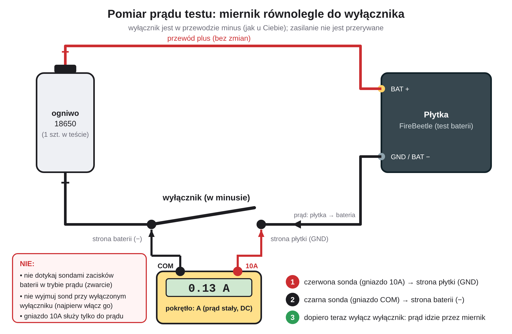

# Checklist before mounting the meter

Decisions and open items collected while building the project. Tick them off before the box goes outside.

## Firmware (`firmware/gas_meter`)

- [ ] **Green LED off.** `#define STATUS_LED 0` once everything works (the LED on GPIO2 lights while the chip is
      awake; it costs roughly 0.2-0.5 mAh per day). Keep it on while testing at the desk.
- [ ] **Access point.** Flash, let it connect, read *Access point* and the signal in the panel (Network tab). If it is
      the outdoor Deco at about -40 dBm, put its 2.4 GHz BSSID into `secrets.h` as `WIFI_PREFERRED_BSSID`
      (a mesh has several nodes with the same name, the meter does not roam between them).
- [ ] **IP address.** A DHCP reservation in the Deco app is enough. `USE_STATIC_IP 1` saves about 0.015 mAh per session.
- [ ] **Battery divider.** `BATTERY_DIVIDER 2.044f` is set (measured 2.034-2.039, stable from 4.07 V to 3.65 V).
      Compare with a multimeter once more on the real battery.
- [ ] **Send interval.** `MIN_SEND_INTERVAL_S 20` gives near live data. A larger value (for example 300) cuts the
      WiFi sessions about 10 times and is the biggest lever for battery life. No pulse is ever lost either way.
- [ ] **Desk test.** Short the reed with a wire a few times and compare the counter with the number of shorts.

## Home Assistant app

- [ ] **Meter reading.** Set the real reading with *Settings > Set meter reading* (about 7282.xx m3, the app converts
      it to pulses). The old retained `Gaz/Gazomierz/counter` on the broker would otherwise be restored.
- [ ] **History of the old sensor.** Rename the old entity (add `_old`), give the new meter entity the old entity id,
      set the meter reading first so the values are continuous. Otherwise add both sources in the Energy dashboard.
- [ ] **Battery settings** in the app options: `battery_preset`, `battery_cells`, `battery_usable_pct`.
- [ ] **Discharge test finished.** Type the test current (multimeter in series) and the number of cells in the
      *Battery* tab; the real capacity and the discharge curve are learned and saved.
- [ ] **Notifications.** *Battery* tab: tick the people who should get the messages and press *Send a test*.
- [ ] **Simulator on GitHub Pages.** Settings > Pages > branch `main`, folder `/docs`.

## Measuring the current of the discharge test

Do it while the test runs and **without ever interrupting the power** (an interruption restarts the test sketch).

1. Multimeter: selector on **A with a DC symbol**, red probe in the **10A** jack, black probe in **COM**. Use the 10A jack: the
   mA jack usually has a 200 mA fuse and the WiFi bursts of the test can blow it. The display then shows for example `0.13`
   (0.13 A = 130 mA).
2. The power switch (in the minus wire) stays **on**. Find its two terminals: the battery side and the board side (GND).
3. Black probe (COM) to the **battery side**, red probe (10A) to the **board side**. The closed switch shorts the meter,
   it shows about 0.00 and the board keeps running.
4. Turn the switch **off**. The current now flows through the meter. Wait about 10 seconds and watch the display for a
   minute. The value jumps with the WiFi activity, note the typical middle value (about 120-150 mA is expected).
5. Turn the switch **on again before** you take the probes off.
6. In the app: *Battery* tab, card *Capacity of your cell (from the test)*: type the current in mA (0.13 A = 130) and the
   number of cells in the test. When the test reaches 3.0 V, open the *Battery* tab and the *Discharge test* view once so that the
   result is stored.

Never touch the battery terminals with the probes while the meter is set to current (a short circuit). A negative reading only
means that the probes are swapped.

## Battery and wiring

- [ ] Two cells **in parallel**, never in series. Charge both to the same voltage (within about 0.1 V) before joining them.
- [ ] Measure the sleep current of the real board with a multimeter in series (expected about 30-35 uA with the
      divider; far above 100 uA means something else draws current).

## Ideas, not done yet

- Firmware stage 2: read the settings from MQTT, service mode, OTA with rollback, network change with automatic revert,
  and switching the LED from the panel.
- After about 8 failed WiFi attempts in a row, retry every hour instead of every 15 minutes (a long power cut then costs
  about 8 mAh per day instead of about 30).
- Option for the measured board sleep current in the app, so the prediction is more exact.
- Seasonal battery forecast from past gas use and the outdoor temperature (degree days), with a range for a cold
  and a warm year.
- Combine the gas use with the smart boiler (heating versus hot water, burner time) once the boiler model is known.
